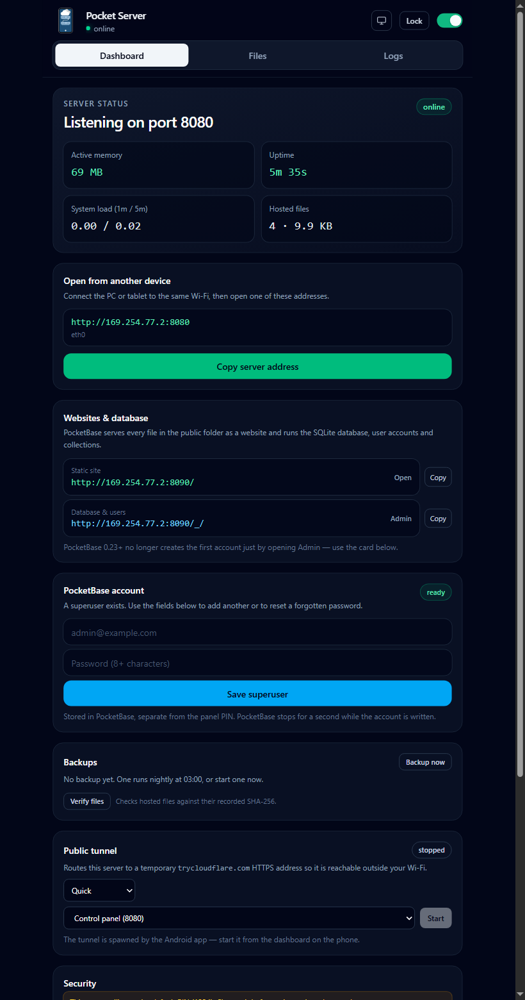
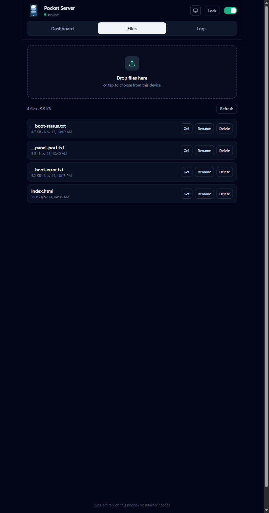
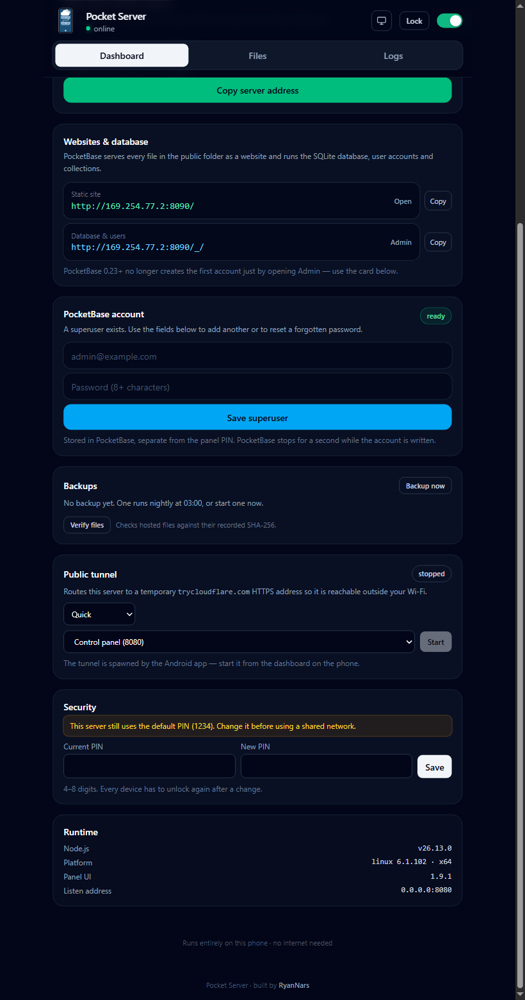
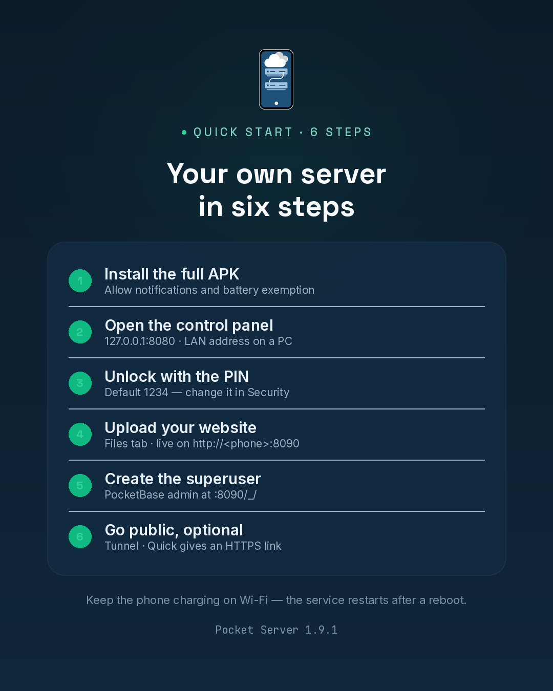
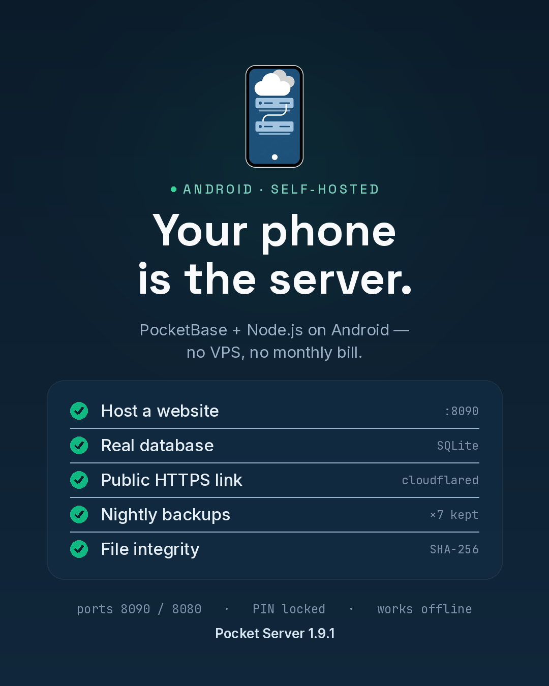
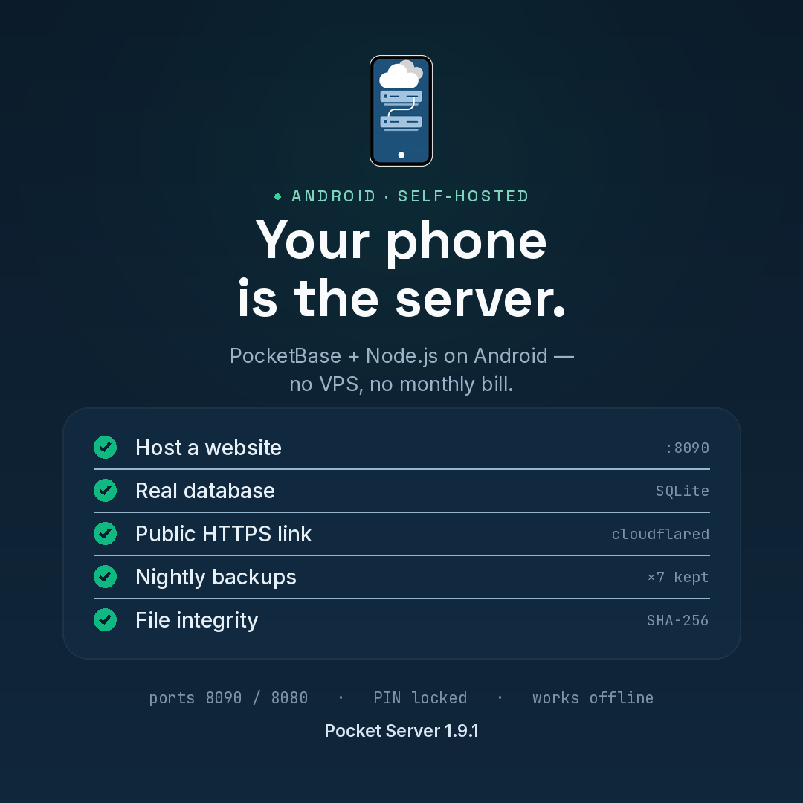
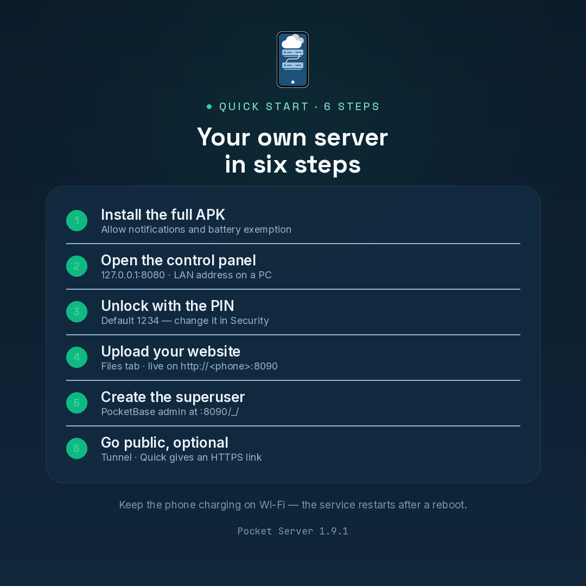

# Pocket Server

Turn an Android phone into a self-contained local server: a website host, a SQLite
database with real user accounts, a PIN-gated file manager, and an optional public
tunnel — all running on the device, installable as one APK.

Two servers run side by side:

| | Port | What it is |
|---|---|---|
| **PocketBase** (native arm64 binary) | **8090** | SQLite, user accounts/auth, collections, admin UI at `/_/`, and the static site host for `pb_public/` |
| **Express control panel** (Capacitor Node runtime) | **8080** | Live dashboard, PIN-gated file manager (upload / rename / delete), tunnel switch (quick or named), diagnostics tab with per-process logs and restart buttons, links to the PocketBase admin |

```
PC / tablet on the same Wi-Fi                       The phone (single APK)
                                         ┌──────────────────────────────────────────────┐
 http://192.168.x.x:8080  ───────────────►│ Express :8080  (Node 18, in-process)          │
   dashboard + file manager              │    writes ──► filesDir/pb_public               │
                                         │  PocketBase :8090 (child process)              │
 http://192.168.x.x:8090  ───────────────►│    serves ──► filesDir/pb_public   (website)   │
   hosted sites + /_/ admin + REST API   │    data   ──► filesDir/pb_data     (SQLite)    │
                                         │  cloudflared (child process) ──► public URL    │
 https://xxx.trycloudflare.com ─────────►│  ForegroundService + partial wake lock         │
                                         └──────────────────────────────────────────────┘
```

## Screenshots

| Control panel | File manager |
| --- | --- |
| [](docs/screenshots/dashboard.png) | [](docs/screenshots/files.png) |
| **Backups, tunnel and security** | **Quick start, six steps** |
| [](docs/screenshots/backups-and-tunnel.png) | [](docs/screenshots/guide-portrait.png) |

Posters for a store listing, a post or a printed card:

| Poster 1080×1350 | Poster 1080×1080 | Guide 1080×1350 | Guide 1080×1080 |
| --- | --- | --- | --- |
| [](docs/screenshots/poster-portrait.png) | [](docs/screenshots/poster-square.png) | [](docs/screenshots/guide-portrait.png) | [](docs/screenshots/guide-square.png) |

## Why the servers survive the screen locking

`ServerService` is a **foreground service** (`foregroundServiceType="specialUse"`,
`START_STICKY`) that:

- holds a **`PARTIAL_WAKE_LOCK`** so the CPU keeps running with the screen off;
- starts, logs and **restarts PocketBase** (5 attempts, linear backoff);
- owns the **cloudflared** child process and reports its URL;
- keeps the app process alive — which is also what keeps the in-process Node runtime,
  and therefore the Express panel, serving.

`specialUse` is used instead of `dataSync` on purpose: Android 15 caps `dataSync`
foreground services at 6 hours per day, which would break an always-on server.

**After a reboot** (`BootReceiver` on `BOOT_COMPLETED` / `MY_PACKAGE_REPLACED`) the
service comes back, so PocketBase — database, admin and hosted website — is reachable
again without touching the phone. The **control panel is not**, because the Capacitor
Node plugin only starts Node when the app is opened, and Android forbids starting
activities from the background. Open the app once after a reboot to bring the panel up.

The notification has two actions: **Stop** and **Battery** (opens the ignore-battery-
optimisation prompt; on Samsung also set Settings → Apps → Pocket Server → Battery →
Unrestricted).

## Why the binaries are called `lib*.so`

Since Android 10 (API 29), apps cannot `exec` files from their writable data directory.
The APK's native library directory is the only place the OS still allows execution, so:

- `jniLibs/arm64-v8a/libpocketbase.so` — official PocketBase `linux_arm64` release
  (statically linked, no libc dependency) served from `applicationInfo.nativeLibraryDir`;
- `jniLibs/arm64-v8a/libcloudflared.so` — cloudflared built for Android/bionic
  (interpreter `/system/bin/linker64`, needs only `libc`, `libdl`, `liblog`).

## Project layout

| Path | Purpose |
| --- | --- |
| `public/index.html`, `public/app.js`, `public/app.css` | Dashboard + Files + Logs tabs (Capacitor `webDir`) |
| `public/nodejs/server.js` | Express backend: status, files API, PIN auth, sessions, rate limits, tunnel control |
| `public/nodejs/www/` | Generated copy of the UI that Express serves to LAN browsers |
| `src/input.css` | Tailwind v4 entry (compiled locally so the panel works offline) |
| `scripts/sync-ui.mjs` | Copies the UI into the Node project |
| `capacitor.config.json` | `webDir`, Node plugin autostart, cleartext LAN serving |
| `android/.../ServerService.java` | Foreground service: wake lock, PocketBase supervisor, tunnel, notification |
| `android/.../BootReceiver.java` | Restart after reboot / app update |
| `android/app/src/main/jniLibs/arm64-v8a/` | Bundled PocketBase + cloudflared binaries |
| `docs/screenshots/` | Screenshots, posters and the quick-start guide used by this README |
| `third-party/` | Upstream licences for the bundled binaries |
| `apk/pocket-server-arm64-debug.apk` | Prebuilt debug APK (arm64) |
| `data/` | Desktop-development stand-in for phone app storage (gitignored) |

## Two editions

| Edition | Size | Contains |
| --- | --- | --- |
| **lite** | ~60 MiB | panel + PocketBase |
| **full** | ~70 MiB | adds `cloudflared` for the public tunnel |

They share the same package id, so installing one replaces the other. On the lite build the
tunnel card reports `unavailable` instead of failing silently. Native libraries are
**compressed** (`useLegacyPackaging`), so they extract on install — that is what took the APK
from 241 MiB down to ~60 MiB.

## Security model

- **PIN** (default `1234`, 4–8 digits) unlocks the panel. Five wrong attempts per IP per
  10 minutes, then `429`.
- **Sessions** are 256-bit random tokens, persisted in `sessions.json` (so a restart does
  not sign you out), idle-expiring after 30 days, capped at 10 devices, and **all revoked
  when the PIN changes**.
- Every `/api` call is limited to 240 requests/minute per IP; `trust proxy` is
  `loopback`, so behind cloudflared the limit applies to the real client IP rather than
  the tunnel process.
- Security headers: `X-Content-Type-Options`, `Referrer-Policy`, and a CSP
  (`script-src 'self'`, `connect-src 'self' http://127.0.0.1:*`, `frame-ancestors *` so
  the dashboard can still be embedded in a preview frame).
- Filenames are sanitised on read, write and rename (`..` and separators rejected), upload
  is capped at 20 files × 1 GB.
- PocketBase keeps its own superuser auth for the admin UI and its REST API.
- **The tunnel is the exposure point.** A quick tunnel makes the panel (or the site)
  reachable from the internet with nothing but the PIN in front of it, over HTTPS. Use a
  long PIN, and stop the tunnel when you are done.

## Requirements

- **Node.js 22+**, **JDK 21**, **Android SDK 36** (or Android Studio Otter 2025.2.1+).
- An **arm64** Android phone (Galaxy A07 and most modern Samsungs). The APK is arm64-only.

## Run the panel on a PC

```bash
npm install        # also installs express + multer into public/nodejs
npm start          # builds CSS, syncs the UI, serves http://localhost:8080
```

Unlock with **1234**. The tunnel switch is disabled on a PC because only the Android
service can spawn `cloudflared`. To rehearse the full pair:

```bash
# terminal 1
./pocketbase serve --http=127.0.0.1:8090 --dir=./data/pb_data --publicDir=./data/pb_public
# terminal 2
npm start
```

## Windows build

The panel is unchanged on a PC: `windows/supervisor.js` replaces the Android
foreground service and speaks the same protocol (command files in, status JSON out),
so the power switch, backups, the superuser card and the tunnel all work there too.

```bat
:: portable download: run the launcher, no install
"Pocket Server.bat"

:: from a source checkout
npm install
node windows/launch.js
```

Build the shippable folder with `npm run windows:fetch` (node.exe, pocketbase.exe,
cloudflared.exe) and `npm run windows:pack` — it writes
`dist/PocketServer-<version>-windows-x64.zip`. Firewall rules, autostart, data
locations and troubleshooting: [docs/windows.md](docs/windows.md).

## Build the APK

```bash
npm install
npm run sync:ui            # Tailwind build + copy the UI into the Node project
npx cap add android        # first time only
npm run cap:sync           # copies public/ + plugins into android/
cd android && ./gradlew assembleLiteDebug assembleFullDebug
# → android/app/build/outputs/apk/lite/debug/app-lite-debug.apk
# → android/app/build/outputs/apk/full/debug/app-full-debug.apk
```

```bash
adb install -r android/app/build/outputs/apk/full/debug/app-full-debug.apk
```

`npm run apk:full` / `npm run apk:lite` do sync + build in one step. The first Gradle run
downloads Gradle, AGP and the nodejs-mobile runtime binaries, so it needs internet.

## Signing the release APK

Release builds are signed with a key in `android/`. Both files already exist here and are
git-ignored:

| File | What it is |
| --- | --- |
| `android/pocketserver-release.jks` | 4096-bit RSA key, alias `pocketserver`, valid 10 000 days |
| `android/keystore.properties` | `storeFile` / `storePassword` / `keyAlias` / `keyPassword` used by Gradle |

The password lives only in `keystore.properties` (mode 600); Gradle reads it, so you never
type it. **Back up both files somewhere safe** — without the key you cannot install an
update over an existing install, and a differently-signed APK is refused by Android until
the old one is uninstalled (which deletes its data).

```bash
npm run apk:lite:release     # → android/app/build/outputs/apk/lite/release/app-lite-release.apk
npm run apk:full:release     # → android/app/build/outputs/apk/full/release/app-full-release.apk
adb install -r android/app/build/outputs/apk/full/release/app-full-release.apk
```

`build.gradle` reads `android/keystore.properties` at configuration time (a relative
`storeFile` is resolved against `android/`, not `android/app/`), and falls back to
environment variables so CI never needs the file:

```bash
POCKET_SERVER_KEYSTORE=/secure/pocketserver-release.jks \
POCKET_SERVER_STOREPASS=... POCKET_SERVER_KEYALIAS=pocketserver \
POCKET_SERVER_KEYPASS=... ./gradlew assembleFullRelease
```

An unsigned release APK cannot be installed, so Gradle fails the build with an explicit
message if no key is found instead of producing one.

To use your own key instead, generate it and rewrite the properties file (values with
spaces or `:` must be escaped for Java properties):

```bash
cd android
keytool -genkeypair -keystore my-release.jks -alias pocketserver \
  -keyalg RSA -keysize 4096 -validity 10000
printf '%s\n' 'storeFile=my-release.jks' 'storePassword=...' \
  'keyAlias=pocketserver' 'keyPassword=...' > keystore.properties
```

`keytool` without a TTY also needs `-storepass`, `-keypass` and `-dname`;
`-dname "CN=Pocket Server,O=Pocket Server,C=US"` matches the key already in this repo.

These Android edits are already applied and survive rebuilds; re-apply them only if you
delete and regenerate `android/`:

- `AndroidManifest.xml`: `usesCleartextTraffic="true"`, the `<service>` and `<receiver>`
  blocks, and the `WAKE_LOCK`, `FOREGROUND_SERVICE`, `FOREGROUND_SERVICE_SPECIAL_USE`,
  `POST_NOTIFICATIONS`, `RECEIVE_BOOT_COMPLETED`, `REQUEST_IGNORE_BATTERY_OPTIMIZATIONS`
  permissions.
- `app/build.gradle`: `ndk { abiFilters 'arm64-v8a' }`.

### Signed release

```bash
keytool -genkey -v -keystore pocket-server.keystore -alias pocket-server \
        -keyalg RSA -keysize 2048 -validity 10000
# add a signingConfigs.release block to android/app/build.gradle, then:
cd android && ./gradlew assembleRelease
```

## First run on the phone

1. Install and open **Pocket Server**. Grant notifications when asked — the foreground
   notification is what keeps Android from freezing the servers.
2. Unlock the panel with **1234** and change it under **Security**.
3. **PocketBase account** card → email + password (8+ characters) → **Create superuser**.
   PocketBase 0.23+ no longer creates the first account just by opening `/_/`, and the
   installer link it prints points at `0.0.0.0`, which a phone cannot open — the app
   captures that link (valid 30 minutes) and can also create or reset the account through
   the PocketBase CLI. That account is what owns users, collections and records.
4. Uploads land in `pb_public` and are live immediately at
   `http://<phone-ip>:8090/<file>`; an `index.html` becomes the site root. Tap a file name
   to copy its URL; **Rename** and **Delete** work in place.
5. **Public tunnel** → pick *Quick* or *Named*, then **Start**.
   - *Quick* also needs a target (control panel 8080 or hosted site 8090) and gives a
     random `https://xxx.trycloudflare.com` address each time.
   - *Named* uses a token from Cloudflare (Zero Trust → Tunnels → create → copy token),
     pasted into the card and saved on the device only. The hostname is whatever public
     hostname you point at this server in the Cloudflare dashboard; the address is stable.

   The card shows the live URL and the notification mirrors it.
6. Exempt the app from battery optimisation (notification **Battery** action).

## API (control panel, port 8080)

Every route except `/api/health` and `/api/login` requires `X-Pocket-Token`.

| Method | Route | Purpose |
| --- | --- | --- |
| `GET` | `/api/health` | Liveness check |
| `POST` | `/api/login` | `{ pin }` → `{ token }` |
| `POST` | `/api/pin` | `{ currentPin, newPin }` → new token, all other sessions revoked |
| `GET` | `/api/status` | Uptime, memory, load, addresses, file totals, PocketBase port |
| `GET` | `/api/files` | List hosted files |
| `POST` | `/api/upload` | `multipart/form-data`, field `files` |
| `GET` | `/api/files/:name/download` | Download a file |
| `POST` | `/api/files/:name/rename` | `{ name }` |
| `DELETE` | `/api/files/:name` | Delete a file |
| `GET` | `/api/tunnel` | Tunnel state + URL (`available` is false off-device) |
| `POST` | `/api/tunnel` | `{ action: "start" \| "stop", mode: "quick" \| "named", target: "panel" \| "site" }` |
| `POST` | `/api/tunnel/token` | `{ token }` — store the named-tunnel token (never returned by the API), `""` clears it |
| `GET` | `/api/superuser` | `{ needsSetup, installer: { url, lanUrl, expiresAt }, result }` — the captured first-superuser link and the last CLI result |
| `POST` | `/api/superuser` | `{ email, password }` — creates or resets the PocketBase superuser (8+ characters); the service stops the DB, runs `superuser upsert`, restarts it. `501` off-device |
| `GET` | `/api/backup` | Last backup status plus the newest files with sizes |
| `POST` | `/api/backup` | Ask the service for an immediate backup; one also runs nightly at 03:00 |
| `GET` | `/api/integrity` | Re-hashes hosted files against the SHA-256 recorded at upload: `{ ok, checked, changed, missing, untracked }` |
| `GET` | `/api/power` | `{ on, at, available }` — the service is the source of truth for the master switch |
| `POST` | `/api/power` | `{ on: true \| false }` — stops/starts PocketBase and the tunnel, keeps the panel reachable; `501` off-device |
| `GET` | `/api/logs?source=pocketbase\|cloudflared` | Tail of the log the Android service writes for each process |
| `POST` | `/api/service` | `{ action: "restart-pocketbase" \| "restart-tunnel" }` |

The tunnel commands travel through `tunnel.command.json` / `tunnel.status.json` in app
storage, because the Node runtime cannot spawn processes on Android — the foreground
service polls the command file once a second.

## Updating the bundled binaries

**PocketBase** (currently v0.40.6, MIT):

```bash
unzip pocketbase_<ver>_linux_arm64.zip pocketbase
cp pocketbase android/app/src/main/jniLibs/arm64-v8a/libpocketbase.so
cp CHANGELOG.md LICENSE.md third-party/pocketbase/
cd android && ./gradlew assembleDebug
```

**cloudflared** (currently 2026.11.0, Apache-2.0, from the Termux aarch64 package — the
upstream `linux-arm64` release is glibc-linked and will not run on Android):

```bash
# https://packages.termux.dev/apt/termux-main/pool/main/c/cloudflared/
ar x cloudflared_<ver>_aarch64.deb && tar -xf data.tar.xz
cp data/data/com.termux/files/usr/bin/cloudflared android/app/src/main/jniLibs/arm64-v8a/libcloudflared.so
```

## Troubleshooting

| Symptom | Fix |
| --- | --- |
| Panel is fine, `:8090` links are dead | PocketBase did not start: `adb logcat -s PocketServer PocketBase`. |
| `PocketBase binary missing from the APK` | `jniLibs/arm64-v8a/libpocketbase.so` not packaged — check `abiFilters`, rebuild. |
| Tunnel says `error` | `adb logcat -s PocketServer Cloudflared`. TLS failures usually mean no internet from the phone; the CA path is forced to `/system/etc/security/cacerts`. |
| Dashboard says `No superuser yet` and Admin only shows a login form | Expected on PocketBase 0.23+: the first account cannot be created at `/_/` any more. Use the **PocketBase account** card (email + 8-character password), or the **Open installer link** button it exposes (30-minute token). |
| Superuser creation says `password: Must be at least 8 character(s)` | PocketBase's own minimum. Use 8 or more characters. |
| Tunnel log shows `Failed to refresh DNS local resolver` / `[::1]:53: connection refused` | Cloudflared uses Go's resolver, which reads `/etc/resolv.conf`; Android has none, so it fell back to `[::1]:53`, where nothing listens — every re-resolve failed and quick tunnels dropped. Fixed in 1.6: cloudflared is launched with `GODEBUG=netdns=cgo` (this binary is a cgo build, so it uses Android's own resolver through netd), retried once with `--dns-resolver-addrs 1.1.1.1:53` if that still fails. The startup line in the log names the mode: `resolver system`. |
| Tunnel stays `starting` | Cloudflare quick tunnels can take ~10 s; if it never resolves, stop and start again. |
| `429 Too many requests` | Rate limit (240/min per IP, or 5 login attempts / 10 min). Wait it out. |
| **PIN is rejected in the app / the gate never unlocks** | Fixed in 1.1: the page used to accept *any* 200 answer as the server, and Capacitor's own local server replies to unknown paths with `index.html`, so every API call (including `/api/login`) went to the wrong place. `resolveApiBase()` now requires the real `{"ok":true}` health payload. If the PIN was changed on an earlier install, app data outlived the update — clear it in *Settings → Apps → Pocket Server → Storage → Clear data* (this also deletes uploads and PocketBase data). |
| `INSTALL_FAILED_UPDATE_INCOMPATIBLE` | The debug and release APKs are signed with different keys. Uninstall the old one first (its data goes with it), or install the matching edition. |
| Pin the tunnel and the PIN is wrong | Change the PIN before starting the tunnel; sessions are revoked on change. |
| Everything dies when idle | Battery optimisation still on, or an OEM task killer — use the notification's **Battery** action. |
| Unknown path on `:8090` returns the site instead of 404 | PocketBase's `--indexFallback` is on (good for SPAs); disable it in `ServerService` for strict 404s. |

## Credits

Built by **RyanNars**.

Third-party components and their licences are listed in `third-party/`:
PocketBase (MIT), Cloudflare cloudflared (Apache 2.0), Node.js and nodejs-mobile,
Capacitor (MIT), Express (MIT), multer (MIT).

## Known limitations

- **APK is ~60 MiB (lite) / ~70 MiB (full)** after compressing the native libraries
  (`libnode.so` alone is 123 MB raw). Because they are compressed, they are extracted on
  install, so the on-device footprint is still ~190 MB and first launch pays a one-off
  extraction cost.
- The embedded Node runtime is **Node 24.5.0** (what this nodejs-mobile build ships;
  `/api/status` and the boot log report the exact version). PocketBase and cloudflared
  are current.
- Quick tunnels are ephemeral (a new hostname each start) and rate-limited by Cloudflare;
  a stable hostname needs a named tunnel plus a Cloudflare account.
- Plain HTTP on the LAN. Public traffic is HTTPS via the tunnel only.
- The control panel needs the app to have been opened since the last reboot.
- **Nothing here has been executed on a physical phone.** Verified: PocketBase static
  hosting / admin / REST API, panel upload-rename-delete against a live PocketBase,
  session persistence and revocation, login throttling, security headers, tunnel command
  round-trip, and the APK's structure (arm64 libs, service + receiver + permissions,
  compiled classes). Not verified on hardware: `exec` from `nativeLibraryDir`, wake-lock
  behaviour, the actual trycloudflare handshake, and the WebView talking to both ports.
